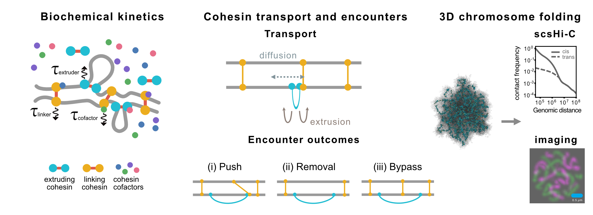

# Sister cohesin dynamics

A multiscale framework linking cohesin regulation and dynamics to sister-chromatid folding.



## Overview

The framework connects biochemical kinetics of cohesin regulation (chemistry/) to cohesin transport and encounters on sister-chromatid lattices (discrete_time_extrusion_sister/), and maps the resulting cohesin configurations onto 3D polymer simulations of sister chromosome folding (polymer_sister_chromatids/). The framework supports condition-specific cohesin kinetics, linker–extruder encounters, extruder diffusion, and comparison of simulated chromosome conformations with scsHi-C and imaging observables.

## Workflow
The workflow consists of four stages spanning biochemical kinetics, one-dimensional cohesin dynamics, three-dimensional polymer simulations, and contact-map analysis.
1. **Biochemical kinetics — `chemistry/`**

   Parameterizes the cohesin reaction network from cohesin-regulator abundance and binding measurements, derives condition-specific transition kinetics for WT and perturbation conditions.
   See [`chemistry/README.md`](chemistry/README.md).

2. **Cohesin transport and encounters — `discrete_time_extrusion_sister/`**

   Simulates loop-extruding and sister-linking cohesins on paired sister-chromatid lattices. The lattice model couples loop extrusion and cohesin transport to condition-specific biochemical kinetics and linker-extruder encounter rules, including pushing, collision-mediated removal, and bypass.
   Condition-specific simulations are implemented in `WT_dS.py` and `dW_dSdW.py`; sister-linking cohesin dynamics are implemented in `sister_lifecycle.py`.
   See [`discrete_time_extrusion_sister/README.md`](discrete_time_extrusion_sister/README.md).

3. **3D chromosome folding — `polymer_sister_chromatids/`**

   Maps linker and extruder configurations generated by the lattice simulations onto a two-sister-chromatid polymer model. Sister-linking cohesins are represented as inter-sister bonds, whereas loop-extruding cohesins are represented as bonds between the two extruder legs. Simulations use HOOMD-blue and polychrom-hoomd, with FIRE relaxation followed by Langevin molecular dynamics.
   See [`polymer_sister_chromatids/README.md`](polymer_sister_chromatids/README.md).

4. **Contact-map and P(s) analysis — `analysis/`**

   Extracts intra-chromatid (cis) and inter-sister (trans) contacts from the
   polymer trajectories using a distance cutoff of 2.3 monomer diameters.
   The resulting contact matrices are converted into contact-probability
   curves as a function of genomic separation, P(s), for comparison with
   experimental scsHi-C data. `contacts_vs_distance_from_trajectories.py` performs contact extraction,
   and `P_s_example.ipynb` provides an example comparing simulated
   and experimental cis and trans P(s).

## Additional analyses

`polymer_sister_chromatids/Sweep_S8h/` contains a separate parameter sweep examining how sister-linking cohesin density and misalignment affect 3D chromosome folding. Sister linkers are initialized at specified densities and misalignments.

## Requirements

- **`chemistry/`**: `sympy`
- **`discrete_time_extrusion_sister/`**: `numpy`, `numba`
- **`polymer_sister_chromatids/`**: [`HOOMD-blue`](https://hoomd-blue.readthedocs.io/), [`polychrom-hoomd` project fork](https://github.com/Fudenberg-Research-Group/polychrom-hoomd/tree/2633b18951b281802fa2d9170270373a055d5084) (based on [`open2c/polychrom-hoomd`](https://github.com/open2c/polychrom-hoomd)), `gsd`
- **`analysis/`**: `numpy`, `scipy`, `h5py`, `gsd`, `cooler`, `cooltools`, `polykit`, `matplotlib`, `pandas`

## Installation and tested system

The full production workflow was tested on Rocky Linux 8.10 (x86_64) with Python 3.10.16. Exact dependency versions are recorded in `environment.yml`.

The cluster environment used an AMD EPYC 9534 CPU and an NVIDIA L40S GPU with 46 GB VRAM, NVIDIA driver 580.159.04, and CUDA runtime 11.8. The chemistry and lattice stages run on CPU. A CUDA-capable GPU is required for the full-scale polymer simulations. The contact-map analysis requires a high-memory node; see `analysis/README.md` for memory estimates.

For the CPU-only quick demo on a desktop computer, create the lightweight environment from the repository root:

```bash
conda create -n sister-cohesin-demo -c conda-forge \
  python=3.10.16 numpy=1.23.5 scipy=1.15.2 \
  pandas=2.2.3 sympy=1.13.3 numba=0.60.0
conda activate sister-cohesin-demo
```

Creating this demo environment took approximately 6 minutes on a MacBook Pro with an Apple M1 Pro processor and 16 GB RAM, running macOS 15.2 (arm64).

For the full production workflow on a Linux system with a CUDA-capable GPU, create the production environment:

```bash
conda env create -f environment.yml
conda activate sister-cohesin
```

## Quick demos

### Chemistry parameter generation

The included WT12h network configuration provides a small CPU-only demo of the biochemical parameter-generation stage. From the repository root, run:

```bash
mkdir -p demo/demo_output
cd demo/demo_output
python ../../chemistry/Step3_Extrusion_Parameters/WT12h_rates.py
cd ../..
```

The expected output file is:

```text
demo/demo_output/WT12h/WT12h_alpha50000_tau11h_beta0_gamma0.json
```

A successful run ends with:

```text
All simulations complete!
```

The demo completed in approximately 3 seconds on a MacBook Pro with an Apple M1 Pro processor and 16 GB RAM, running macOS 15.2 (arm64).

### Reduced-size sister-lattice simulation

The lattice demo reuses the production WT12h rates but reduces each chromatid to a 1 Mb (400-site) lattice with nine extruders, four paired sister linkers at deterministic local positions, and 1,000 simulation steps. The script automatically applies the second-chromatid coordinate offset. From the repository root, run:

```bash
python demo/run_lattice_demo.py
```

The expected output files are:

```text
demo/demo_output/lattice/summary.json
demo/demo_output/lattice/lattice_demo_trajectory1_0.pkl
demo/demo_output/lattice/lattice_demo_trajectory2_0.pkl
```

A successful run prints `Lattice demo complete`. The demo completed in approximately 3 seconds on the MacBook Pro described above. The summary reports 400 lattice sites per chromatid, nine extruders per chromatid, four sister linkers, 1,000 steps, and 11 saved samples per chromatid.

This reduced-size demo validates the sister-aware lattice execution path and output format; it is not intended to reproduce manuscript-scale results.

Full production runtimes depend on the condition, simulation step count, number of replicas, and available hardware. The exact step counts are documented in the component READMEs.

## Attribution

The loop-extrusion implementation builds on the [discrete-time extrusion framework](https://github.com/Fudenberg-Research-Group/discrete-time-extrusion). See, Tortora et al., *The physical chemistry of interphase loop extrusion* ([Cell Genomics, 2026](https://doi.org/10.1016/j.xgen.2025.101098)).

This work develops a multiscale framework for sister-chromatid cohesion that couples biochemical regulation of sister-linking and loop-extruding cohesins to their dynamics and encounters on paired sister chromatids and to 3D polymer simulations of sister chromosome folding.

## Code availability and license

Code used in this study is publicly available at [sister-cohesin-dynamics GitHub repository](https://github.com/Fudenberg-Research-Group/sister-cohesin-dynamics). The software is distributed under the [MIT License](LICENSE).

**Associated publication:**
> Yan, X., Tortora, M., Goloborodko, A., Fudenberg, G.
> Chromosome folding encodes mechanisms of cohesion maintenance.
> bioRxiv (2026). https://doi.org/10.64898/2026.11.02.763844
