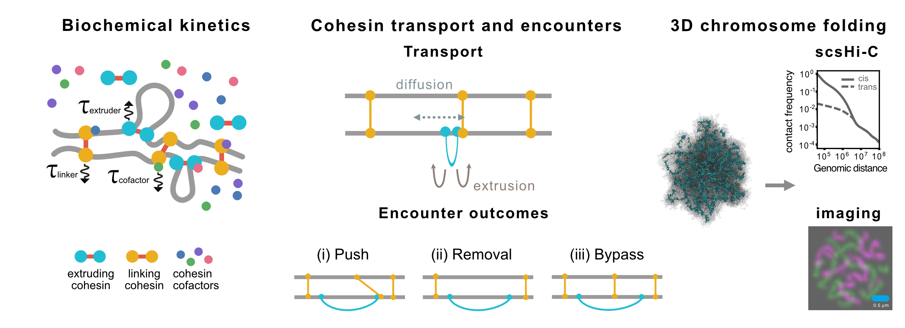

# Sister cohesin dynamics

A multiscale framework linking cohesin regulation and dynamics to sister-chromatid folding.

## Overview

The framework connects biochemical kinetics of cohesin regulation (chemistry/) to cohesin transport and encounters on sister-chromatid lattices (discrete_time_extrusion_sister/), and maps the resulting cohesin configurations onto 3D polymer simulations of sister chromosome folding (polymer_sister_chromatids/). The framework supports condition-specific cohesin kinetics, linker–extruder encounters, extruder diffusion, and comparison of simulated chromosome conformations with scsHi-C and imaging observables.

## Workflow
The workflow consists of four stages spanning biochemical kinetics, one-dimensional cohesin dynamics, three-dimensional polymer simulations, and contact-map analysis.
1. **Biochemical kinetics — `chemistry/`**

   Parameterizes the cohesin reaction network from cohesin-regulator abundance and binding measurements, derives condition-specific transition kinetics for WT and perturbation conditions.
   See [`chemistry/README.md`](chemistry/README.md).

2. **Cohesin transport and encounters — `discrete_time_extrusion_sister/`**

   Simulates loop-extruding and sister-linking cohesins on paired sister-chromatid lattices. The lattice model couples loop extrusion and cohesin transport to condition-specific biochemical kinetics and linker-extruder encounter rules, including pushing, collision-mediated removal, and bypass.
   Condition-specific simulations are implemented in `WT_dS.py` and `dW_dSdW.py`; sister-linking cohesin dynamics are implemented in `sister_lifecycle.py`.
   See [`discrete_time_extrusion_sister/README.md`](discrete_time_extrusion_sister/README.md).

3. **3D chromosome folding — `polymer_sister_chromatids/`**

   Maps linker and extruder configurations generated by the lattice simulations onto a two-sister-chromatid polymer model. Sister-linking cohesins are represented as inter-sister bonds, whereas loop-extruding cohesins are represented as bonds between the two extruder legs. Simulations use HOOMD-blue and polychrom-hoomd, with FIRE relaxation followed by Langevin molecular dynamics.
   See [`polymer_sister_chromatids/README.md`](polymer_sister_chromatids/README.md).

4. **Contact-map and P(s) analysis — `analysis/`**

   Extracts intra-chromatid (cis) and inter-sister (trans) contacts from the
   polymer trajectories using a distance cutoff of 2.3 monomer diameters.
   The resulting contact matrices are converted into contact-probability
   curves as a function of genomic separation, P(s), for comparison with
   experimental scsHi-C data. `contacts_vs_distance_from_trajectories.py` performs contact extraction,
   and `P_s_example.ipynb` provides an example comparing simulated
   and experimental cis and trans P(s).

## Additional analyses

`polymer_sister_chromatids/Sweep_S8h/` contains a separate parameter sweep examining how sister-linking cohesin density and misalignment affect 3D chromosome folding. Sister linkers are initialized at specified densities and misalignments.

## Requirements

- **`chemistry/`**: `sympy`
- **`discrete_time_extrusion_sister/`**: `numpy`, `numba`
- **`polymer_sister_chromatids/`**: [`HOOMD-blue`](https://hoomd-blue.readthedocs.io/), [`polychrom-hoomd`](https://github.com/open2c/polychrom-hoomd), `gsd`
- **`analysis/`**: `numpy`, `scipy`, `h5py`, `gsd`, `cooler`, `cooltools`, `polykit`, `matplotlib`, `pandas`

## Attribution

The loop-extrusion implementation builds on the [discrete-time extrusion framework](https://github.com/Fudenberg-Research-Group/discrete-time-extrusion). See, Tortora et al., *The physical chemistry of interphase loop extrusion* ([Cell Genomics, 2026](https://doi.org/10.1016/j.xgen.2025.101098)).

This work develops a multiscale framework for sister-chromatid cohesion that couples biochemical regulation of sister-linking and loop-extruding cohesins to their dynamics and encounters on paired sister chromatids and to 3D polymer simulations of sister chromosome folding.

## Code availability
Code used in this study is publicly available in this repository.
**Associated publication:**
> Yan, X., Tortora, M., Goloborodko, A., Fudenberg, G.
> Chromosome folding encodes mechanisms of cohesion maintenance.
> bioRxiv (2026). https://doi.org/10.64898/2026.11.02.763844 
