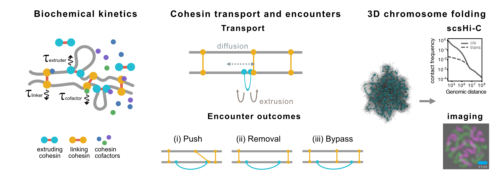

# sister_discrete_translocator

A multiscale framework connecting cohesin biochemistry, sister-chromatid dynamics, and 3D chromosome folding.

**Overview**: The framework connects biochemical kinetics of cohesin regulation (chemistry/) to cohesin transport and encounters on sister-chromatid lattices (discrete_time_extrusion_sister/), and maps the resulting cohesin configurations onto 3D polymer simulations of sister chromosome folding (polymer_sister_chromatids/).

## Description

This repository implements a multiscale framework for simulating sister-chromatid cohesion and loop extrusion during G2. It couples biochemical reaction kinetics of cohesin and its regulators to cohesin dynamics on paired one-dimensional sister-chromatid lattices, and maps the resulting linker and extruder configurations onto 3D polymer simulations of sister chromosome folding. The framework supports condition-specific cohesin kinetics, linker–extruder encounters, extruder diffusion, and comparison of simulated chromosome conformations with scsHi-C and imaging observables. 

## Workflow

The simulation pipeline consists of three stages that correspond to the biochemical, one-dimensional, and three-dimensional components of the model.

1. **Biochemical kinetics — `chemistry/`** 
Parameterizes the cohesin reaction network from cohesin-regulator binding measurements and derives condition-specific transition kinetics for WT and perturbation conditions.
See [`chemistry/README.md`](chemistry/README.md).
2. **Cohesin transport and encounters — `discrete_time_extrusion_sister/`**
Simulates loop-extruding and sister-linking cohesins on paired sister-chromatid lattices. The lattice model couples loop extrusion and cohesin transport to condition-specific biochemical kinetics and linker-extruder encounter rules, including pushing, collision-mediated removal, and bypass.
Condition-specific simulations are implemented in `WT_dS.py` and `dW_dSdW.py`, with sister-linking cohesin dynamics implemented in `sister_lifecycle.py`.
See [`discrete_time_extrusion_sister/README.md`](discrete_time_extrusion_sister/README.md).
3. **3D chromosome folding — `polymer_sister_chromatids/`**
Maps linker and extruder configurations generated by the lattice simulations onto a two-sister-chromatid polymer model. Sister-linking cohesins are represented as inter-sister bonds, whereas loop-extruding cohesins are represented as bonds between the two extruder legs.
Polymer simulations are implemented using HOOMD-blue and polychrom-hoomd and include FIRE relaxation followed by Langevin molecular dynamics.

## Additional analyses 
**`polymer_sister_chromatids/Sweep_S8h/`** contains a separate parameter sweep used to examine how sister-linker density and misalignment influence sister chromosome folding. Sister linkers are initialized at specified densities and misalignments, while loop extrusion is simulated independently on the two sister chromatids.

## Requirements

- **`chemistry/`**: `sympy`, `tellurium`, `pandas`
- **`discrete_time_extrusion_sister/`**: `numpy`, `numba`; `cupy` is optional for GPU acceleration
- **`polymer_sister_chromatids/`**: [`HOOMD-blue`](https://hoomd-blue.readthedocs.io/), [`polychrom-hoomd`](https://github.com/open2c/polychrom-hoomd), `gsd`

## Attribution

The loop-extrusion implementation builds on the discrete-time extrusion framework:

[Fudenberg-Research-Group/discrete-time-extrusion](https://github.com/Fudenberg-Research-Group/discrete-time-extrusion)

See, Tortora et al., *The physical chemistry of interphase loop extrusion* ([Cell Genomics, 2025](https://doi.org/10.1016/j.xgen.2025.101098)).

This work develops a multiscale framework for sister-chromatid cohesion that couples biochemical regulation of sister-linking and loop-extruding cohesins to their dynamics and encounters on paired sister chromatids and to 3D polymer simulations of sister chromosome folding.

## Code availability

Code used in this study is publicly available in this repository.