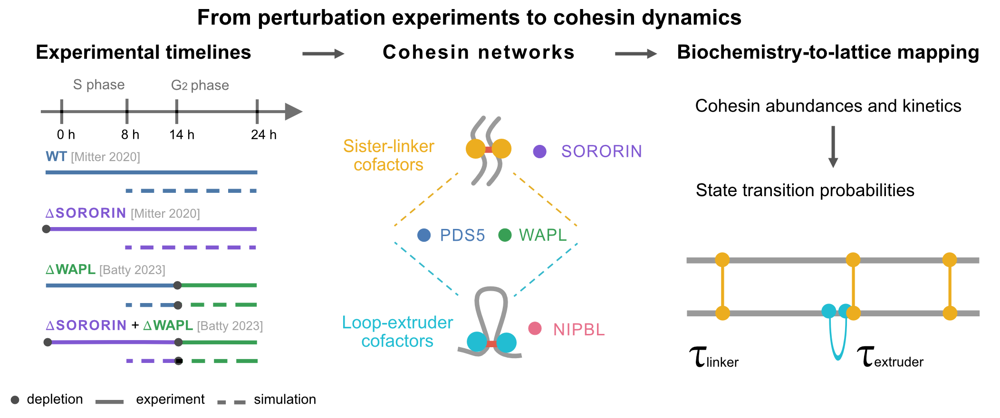

# chemistry/ — cohesin kinetics identification pipeline

Three-step pipeline that derives the kinetic parameters for the loop-extruding and sister-linking cohesins
used by the lattice simulation in `../discrete_time_extrusion_sister/`.



```
chemistry/
├── Step1_Centroid/               # find the (WAPL, PDS5) fraction-bound at linkers centroid
├── Step2_Kinetics/               # validate RAD21 residence-time kinetics at that centroid
└── Step3_Extrusion_Parameters/   # generate the final per-condition extrusion-rate JSONs
```

## Data flow

```
Step1_Centroid/CRN_centroid.ipynb
    → centroid (x, y) ≈ (0.12028, 0.30274)
        → Step2_Kinetics/bounded_linker_over_time_tau10h.ipynb
        → Step3_Extrusion_Parameters/network_parameters_{condition}.json
            → {condition}_rates.py
                → Step3_Extrusion_Parameters/{condition}/{condition}_alpha..._tau..h_beta.._gamma..json
                    → ../discrete_time_extrusion_sister/WT_dS.py, dW_dSdW.py
```

## Step1_Centroid/ — `CRN_centroid.ipynb`

Solves two chemical reaction networks symbolically (sympy): the **linker /
cohesive network** (PDS5, WAPL, Sororin binding + RAD21 unloading) and the
**extrusive network** (NIPBL, PDS5, WAPL binding + RAD21 unloading). Both are
solved for steady-state rate expressions, then evaluated over a grid of
`(x, y)` = (fraction WAPL bound, fraction PDS5 bound at the linkers) to find
the region where every solved rate is positive (the physically valid
"feasible region"). The centroid of that region — currently
`(x, y) ≈ (0.12028, 0.30274)` — is the fitted operating point used
everywhere downstream.

- **Input:** `parameters_10h.json` — base network parameters. `Step2_Kinetics/` reads it from here too.
- **Output:** centroid of the feasible region.

## Step2_Kinetics/ — `bounded_linker_over_time_tau10h.ipynb`

Takes the Step1 centroid, builds the linker/cohesive reaction network, and simulates the fraction of
RAD21-bound cohesin over time (16-18h, spanning G2) for WT and several
depletion conditions: dSororin, dWapl, dWapl+dSororin, dPDS5, and dRAD21.

- **Input:** `../Step1_Centroid/parameters_10h.json`.

## Condition naming

The simulated timeline starts at S-phase entry (S0h) and ends at G2-16h, 24 h
in total (8 h of S phase followed by 16 h of G2). A condition name combines the
perturbation with **the timepoint on that timeline at which its kinetic rates
were evaluated**:

| Name | Perturbation | Rates evaluated at | Lattice resolution | Used by |
|---|---|---|---|---|
| `WT12h` | none | 12 h | 2500 bp/site | `WT_dS.py`, single phase |
| `dS12h` | Sororin depleted | 12 h | 2500 bp/site | `WT_dS.py`, single phase |
| `WT7h` | none | 7 h | 500 bp/site | `dW_dSdW.py`, phase 1 |
| `dS7h` | Sororin depleted | 7 h | 500 bp/site | `dW_dSdW.py`, phase 1 |
| `dW` | WAPL depleted | post-depletion | 500 bp/site | `dW_dSdW.py`, phase 2 |
| `dSdW` | Sororin + WAPL depleted | post-depletion | 500 bp/site | `dW_dSdW.py`, phase 2 |

These labels are independent of the simulation windows inside each
`{condition}_rates.py`, which are expressed relative to the start of that
script's own run (e.g. `WT12h_rates.py` integrates the reaction network for
16 h and reads out at its midpoint).

The `tau11h` that also appears in the parameter filenames is a different
quantity: it is the RAD21 residence time (`RESIDENCE_TIMES_HOURS = [11]`), not
a timepoint.

## Step3_Extrusion_Parameters/ — `{condition}_rates.py`

This is what generates the parameter JSONs read by the lattice simulations in
`../discrete_time_extrusion_sister/`

- **`crn_core.py`** — shared module. Defines the combined cohesive +
  extrusive reaction network (`MODEL_EXT_COH_TEMPLATE`), solves both
  networks symbolically once (`sol_rates_coh`, `sol_rates_ext`), and
  provides the helper functions every condition script uses
  (`build_model`, `calculate_cohesive_parameters`,
  `calculate_extrusive_parameters`, `calculate_sister_RAD21_bound_time`).
- **One script per condition** — `WT12h_rates.py`, `WT7h_rates.py`,
  `dS12h_rates.py`, `dS7h_rates.py`, `dW_rates.py`, `dSdW_rates.py`. Each
  loads its own `network_parameters_{condition}.json`, builds and simulates
  the combined ODE model with tellurium, and derives the LEF on/off/
  transition rates from the simulated state at a chosen analysis timepoint.
  Depletion conditions (`dW`, `dSdW`, ...) additionally simulate a WT run
  first, apply the depletion event partway through (e.g. `dW_rates.py`
  depletes WAPL at 6h), then continue simulating from that post-depletion
  state before extracting rates.
- **`extrusion_dict_RN_RB_RP_RW_HBD_WT.json`** — base template. Each
  condition script loads it and overwrites the rate / species-count fields
  with its own computed values before saving.
- **Output:**
  `{condition}/{condition}_alpha{sister_damping}_tau{residence_time}h_beta{k}_gamma{q}.json`
  — this is the file `../discrete_time_extrusion_sister/WT_dS.py` and
  `dW_dSdW.py` load directly.

Run with, e.g.:

```bash
python WT12h_rates.py
```

No CLI args — the condition, its `network_parameters_*.json`, and the sweep
ranges (residence time / sister damping / collision-release / bypass
probabilities) are set as constants near the top of each script.

Conditions currently generated, and how the run scripts in
`discrete_time_extrusion_sister/` consume them:

| Condition | Used as |
|---|---|
| `WT12h` | `WT_dS.py`, `CONDITIONS["WT"]` |
| `dS12h` | `WT_dS.py`, `CONDITIONS["dS"]` |
| `WT7h` | `dW_dSdW.py`, phase 1 of `CONDITIONS["WT_dW"]` |
| `dW` | `dW_dSdW.py`, phase 2 of `CONDITIONS["WT_dW"]` |
| `dS7h` | `dW_dSdW.py`, phase 1 of `CONDITIONS["dS_dSdW"]` |
| `dSdW` | `dW_dSdW.py`, phase 2 of `CONDITIONS["dS_dSdW"]` |

## Environment

Beyond the usual numpy/scipy/matplotlib stack, this pipeline additionally
needs:

- `sympy` (symbolic CRN solving, all three steps)
- `tellurium` (ODE simulation via Antimony/RoadRunner, Step2 and Step3)
- `pandas` (Step3)

These aren't required by `discrete_time_extrusion_sister/`.
