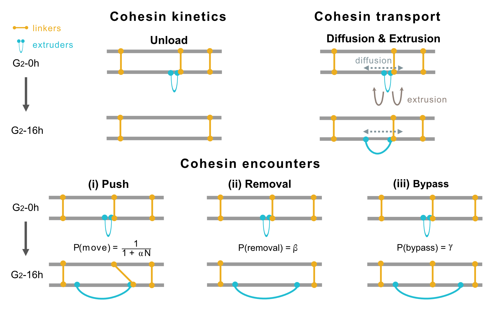

# discrete_time_extrusion (sister-aware fork)

<p align="center">
  
</p>

Sister-chromatid-aware loop-extrusion simulation.  1D lattice LEF model with "sister" anchor per pair of
chromatids, so that cohesin loop extrusion and sister-chromatid cohesion
can be simulated together.

## Repo layout

```
discrete_time_extrusion_sister/
├── WT_dS.py                  # single-phase run: WT alone, or dSORORIN alone
├── dW_dSdW.py                # two-phase run: WT->dW, or dS->dSdW
├── input/
│   ├── anchor_2909_{i}_sister1.txt   # initial sister positions, chromatid 1
│   └── anchor_2909_{i}_sister2.txt   # initial sister positions, chromatid 2
├── output/                   # created automatically when a run script executes
└── discrete_time_extrusion/  # the model package
    ├── Translocator_Sister.py        # one chromatid's translocator
    ├── sister_lifecycle.py           # sister decay/collision + synchronized run loop
    ├── arrays.py                     # shared CTCF/LEF rate-array helpers
    ├── boundaries/                   # CTCF barrier engines
    └── extruders/                    # LEF + sister extruder engines
```

The parameter JSON files are in one level above this folder, in
`../chemistry/Step3_Extrusion_Parameters/{condition}/{condition}_alpha{...}_tau{...}h_beta{...}_gamma{...}.json`
(e.g. `../chemistry/Step3_Extrusion_Parameters/WT7h/WT7h_alpha100_tau11h_beta0_gamma0.json`).
These are produced upstream (Step 3 of the parameter-fitting
pipeline).


## Environment

The lattice simulations use the CPU/Numba backend.
From the repository root, create and activate the environment with:

```bash
conda env create -f environment.yml
conda activate sister-cohesin
```

## Input data

**Config JSON** (one per condition, e.g. `WT7h`, `dS7h`, `dW`, `dSdW`):
holds the physical/simulation parameters read via `**paramdict` in
`Translocator_Sister`, including region size, LEF on/off/diffusion rates,
CTCF stall probabilities, sister lifetime/damping/bypass probability,
number of sisters, and step counts. See `discrete_time_extrusion/arrays.py`
and `Translocator_Sister.py` for the exact keys consumed.

**Anchor files** (`input/anchor_2909_{iteration}_sister1.txt` /
`sister2.txt`): initial sister-cohesin positions per replica/iteration.
These come from a separate sweeping of misalignment and linker
density parameters and identifying the fit to experimental scsHi-C at G2-0h—
not generated inside this repo.

**One example replica (`replica = 0`) is included here.** Both entry scripts
use zero-based replica indices selected with `--replica`; therefore the
included anchor files support `--replica 0`. Replicas 1–4 require the
corresponding additional anchor files.

If `num_of_sisters` in the condition's
JSON is smaller than the number of positions in the anchor file (the dS/
dSdW case), the scripts randomly subsample `num_of_sisters` of them
(same indices for both sister files, seeded by `iteration` for
reproducibility).

## Why one phase or two

The two run scripts correspond to two different experimental designs.

`WT_dS.py` runs a **single phase**: one condition's kinetics apply throughout.
This matches experiments in which the perturbation is present from the start,
so a single set of rates (evaluated at 12 h) describes the whole trajectory.

`dW_dSdW.py` runs **two phases**: it starts under the pre-depletion condition
(`WT7h` or `dS7h`), then `update()` replaces the biochemical rate arrays
(LEF birth, death, stalled death and state transitions) with those of the
post-depletion condition (`dW` or `dSdW`), and the *same* translocators
continue from there. Extruder diffusion and encounter parameters (α, β, γ,
`LEF_diffusion_rate`) are specified once per run by the phase-1 file and held
constant across both phases; WAPL depletion changes only the biochemical
rates and the linker lifetime.

The distinction matters mechanistically, not just bookkeeping-wise: because the
switch is applied to the existing lattice state (`clear_trajectories=False`),
the loops and linkers present at the moment of depletion persist across it, as
they would experimentally. Running two independent simulations instead would
discard that history. `prune_unbound_LEFs` is correspondingly `True` in phase 1
(to reach a steady state) and `False` in phase 2.

### Parameters used in the manuscript

The configuration files in `chemistry/Step3_Extrusion_Parameters/` hold the
biochemical rates for each condition together with default encounter
settings (α = 100, β = 10⁻⁶, γ = 10⁻⁴, no extruder diffusion). To reproduce
a figure, set the fields below in the phase-1 file before running the
lattice stage. Extruder diffusion and encounter parameters are specified
once per run and held constant across both phases; WAPL depletion changes
only the biochemical rates and the linker lifetime.

| Figure | Conditions | Config (phase 1 → phase 2) | bp/site | Δt | α `sister_damping_factor` | β `collision_release_prob` | γ `bypass_prob` | k `LEF_diffusion_rate` | 2D (per leg) |
|---|---|---|---|---|---|---|---|---|---|
| Fig. 3 | WT, ΔSORORIN | WT12h, dS12h | 2500 | 1.25 s | 50000 | 0 | 0 | 0 | 0 |
| Fig. 4 | ΔWAPL, ΔSORORIN+ΔWAPL | WT7h → dW, dS7h → dSdW | 500 | 0.25 s | 100 | 10⁻⁶ | 10⁻⁴ | 0.25 s⁻¹ | 0.0625 kb²/s |
| Sweeps, Fig. S11 | as in figure | as above | | | given in the figure | given in the figure | given in the figure | given in the figure | |

β and γ are per-step probabilities at the stated lattice resolution. The
`beta0_gamma0` in file names are sweep indices, not parameter values.

### Extruder diffusion

Extruder diffusion is off in the main results (`LEF_diffusion_rate = 0`).
When enabled, every lattice step each unstalled extruder leg independently
attempts a one-site move with probability p = k * dt, to the left or right
with equal probability (`DiffusionEngines_Sister.py`). Here k is
`LEF_diffusion_rate` (1/s), dt the lattice time step and dx the site size
(`bp_per_site`). Each leg therefore has mean-squared displacement
<dx^2> = 2 D t with

    2D = p * dx^2 / dt = k * dx^2.

Following the convention of single molecule experiments, we report 2D.
In the two-phase runs (dWAPL / dSORORIN+dWAPL), the diffusion probability
is set by the phase-1 parameters (WT7h, dS7h) and is not changed at the phase switch.

| dx | dt | k | p | 2D |
|---|---|---|---|---|
| 0.5 kb | 0.25 s | 0.25 /s | 0.0625 | 0.0625 kb^2/s |

## Running a simulation

Both entry scripts select the biological condition with `--condition` and the
zero-based replica index with `--replica`. The condition is required; the
replica defaults to 0.

All commands below are run from `discrete_time_extrusion_sister/`; input and
output paths are relative to it.

**Single-phase WT or dSORORIN:**

```bash
cd discrete_time_extrusion_sister
python WT_dS.py --condition WT --replica 0
python WT_dS.py --condition dS --replica 0
```

**Two-phase dWAPL or dSORORIN+dWAPL:**

```bash
python dW_dSdW.py --condition dW --replica 0
python dW_dSdW.py --condition dSdW --replica 0
```

For a cluster job array, pass the task id straight through — note that the
indices are zero-based:

```bash
#SBATCH --array=0-4
python WT_dS.py --condition WT --replica $SLURM_ARRAY_TASK_ID
```

Only replica 0's anchor files ship with this repository; see
[Input data](#input-data) above.


Each script also sets `tau`, `sister_dampings` (alpha),
`collision_prob_index` (beta) and `bypass_index` (gamma) as constants at the
top of `main()`. These select which parameter JSON is loaded and are encoded
into the output folder name — see
[Lattice resolution and the `factor5` output path](#lattice-resolution-and-the-factor5-output-path).

Both designs cover the same 16 h of G2, at different lattice time resolutions:

| Script | Phases | Steps | Seconds per step | Total |
|---|---|---|---|---|
| `WT_dS.py` | 1 | 46,080 | 1.25 | 16 h |
| `dW_dSdW.py` | 2 | 86,400 + 144,000 | 0.25 | 6 h + 10 h = 16 h |

The step counts differ because `bp_per_site` differs between the condition
families (2500 vs 500), so one lattice step is 1.25 s in the 12h conditions and
0.25 s in the 7h ones.

## Lattice resolution and the `factor5` output path

The 12h conditions use 2500 bp per lattice site, matching the 2.5 kb polymer
monomer. The 7h conditions (`WT7h`, `dS7h`, `dW`, `dSdW`) use 500 bp per site,
so one lattice step is 0.25 s instead of 1.25 s. Anchor files are tabulated
in 2.5 kb units, so for these conditions `simulation_setup.anchor_scale`
returns 5 and anchor positions are multiplied by 5. The run then writes into
an extra `factor5/` subdirectory of the usual output folder.

`dW_dSdW_polymer.py` reads from that `factor5/` folder and maps lattice
positions back onto monomers by floor division by 5
(`polymer_common.py`).


## Output

Each run writes to `output/tau{tau}h/{condition}_alpha_{...}_tau_{...}h_beta{...}_gamma{...}/`:

- `{condition}_trajectory1_{iteration}.pkl`, `{condition}_trajectory2_{iteration}.pkl`
  — one per chromatid, each a dict with keys `sister`, `lef`, `ctcf`,
  `state`, `coupling` (trajectories sampled every `sample_interval` steps)
- `ctcf_left_positions_full.npy`, `ctcf_right_positions_full.npy`

